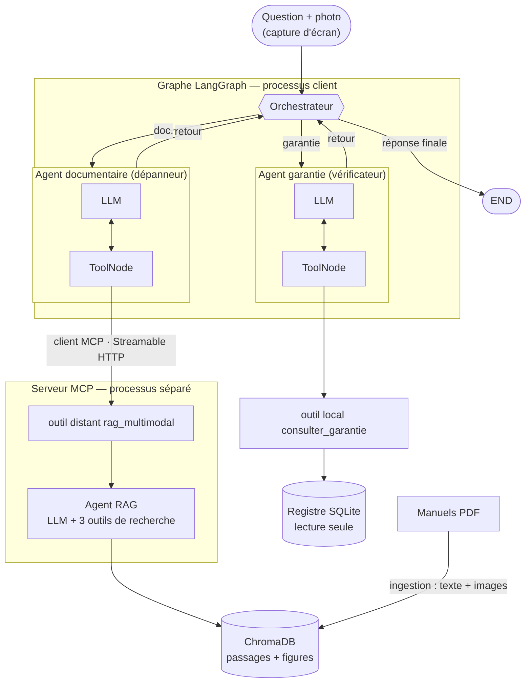

# SAV agentique — LangChain · LangGraph · MCP · RAG multimodal

**Activité pratique n° 5 — IA agentique : service après-vente d'un distributeur d'appareils électroniques.**

Réalisé par : *Nom Prénom* — Encadrant : *Pr. Mohamed YOUSSFI*

## 1. Problème

Le SAV d'un distributeur veut automatiser deux types de demandes :

| Demande | Exemple | Agent |
|---|---|---|
| **Dépannage** à partir d'une question et, éventuellement, d'une photo de l'écran | « Mon imprimante PX-200 affiche un voyant clignotant. Que signifie le pictogramme sur la photo jointe ? » (photo `img_px200_01`) | `agent_documentaire` |
| **Vérification de garantie** à partir d'un numéro de série | « Est-ce que mon imprimante est encore sous garantie ? Son numéro de série est PX200-0042. » | `agent_garantie` |

Chaque demande relève d'**une seule** catégorie.

## 2. Architecture



*Schéma de départ (tableau) : [`docs/schema_tableau.png`](docs/schema_tableau.png) — graphe LangGraph généré par le code : [`docs/graph_langgraph.mmd`](docs/graph_langgraph.mmd).*

Correspondance schéma → code :

| Élément du schéma | Implémentation |
|---|---|
| Orchestrateur (noeud LangGraph) | `orchestrateur` dans [`src/sav/graph.py`](src/sav/graph.py) — classe la demande puis **termine dès qu'une réponse finale existe** (« Finish → END ») |
| Agent dépanneur / agent vérificateur | sous-graphes ReAct `LLM ⇄ ToolNode` construits par [`src/sav/react.py`](src/sav/react.py) ; ils **rendent la main** à l'orchestrateur |
| Serveur MCP (Streamable HTTP) | [`src/sav/mcp_server.py`](src/sav/mcp_server.py) (`FastMCP`, outil `rag_multimodal`) |
| Client MCP | `MultiServerMCPClient` (`langchain-mcp-adapters`) dans `charger_outils_mcp()` |
| « RAG as Tool » | agent RAG : [`src/sav/rag/rag_agent.py`](src/sav/rag/rag_agent.py) (3 outils de recherche + réponse **sourcée**) |
| ChromaDB (texte + images ← PDF) | [`src/sav/rag/ingest.py`](src/sav/rag/ingest.py), [`store.py`](src/sav/rag/store.py), [`search.py`](src/sav/rag/search.py) |
| Outil de vérification `@tool` | `consulter_garantie` dans [`src/sav/tools/garantie.py`](src/sav/tools/garantie.py) (SQLite en **lecture seule**) |

### Déroulement d'une demande

1. `orchestrateur` : le LLM répond `documentation` ou `garantie` (règle de secours déterministe si la réponse est ambiguë).
2. L'agent choisi travaille en boucle ReAct (raisonnement → appel d'outil → observation).
   * documentaire : appelle `rag_multimodal(question, image_ref)` **à distance** via MCP ; derrière, l'agent RAG interroge ChromaDB (passages, figures par texte, figures proches de la photo) et rédige une réponse avec *(manuel, page, figure)*.
   * garantie : appelle l'outil **local** `consulter_garantie(numero_serie)`.
3. L'agent spécialisé retourne à `orchestrateur`, qui voit `reponse_finale` et envoie vers `END`.

Trajet attendu : `orchestrateur → agent_* → orchestrateur`.

## 3. Arborescence

```
.
├── src/sav/
│   ├── graph.py          # état, orchestrateur, agents spécialisés, client MCP, exécution
│   ├── react.py          # agent ReAct LangGraph (noeuds llm / tools)
│   ├── mcp_server.py     # serveur MCP : outil rag_multimodal
│   ├── main.py           # CLI
│   ├── routing.py        # classification + numéros de série
│   ├── llm.py, fake_llm.py
│   ├── rag/              # embeddings, store Chroma, ingestion PDF, recherche, agent RAG
│   └── tools/garantie.py # consulter_garantie
├── scripts/              # setup_demo.py, build_registry.py, make_sample_data.py
├── data/                 # manuel PX-200 (PDF), photo img_px200_01, garanties.csv (données fictives)
├── tests/                # 29 tests (dont bout en bout avec un vrai serveur MCP)
└── docs/
```

## 4. Installation

Prérequis : Python ≥ 3.11 (testé en 3.13), [`uv`](https://docs.astral.sh/uv/) recommandé.

```powershell
git clone <url-du-depot>
cd <dossier>

uv sync --extra clip --extra dev        # ou : pip install -r requirements.txt && pip install -e .
Copy-Item .env.example .env             # puis renseignez OPENAI_API_KEY (ou un LLM Ollama)
```

> `--extra clip` installe `sentence-transformers` (CLIP multilingue ; plusieurs centaines de Mo téléchargés au premier lancement).
> Pour un LLM local : `uv sync --extra ollama` puis `LLM_MODEL=ollama:qwen2.5:7b` dans `.env` (un modèle **avec vision** n'est pas nécessaire : la photo est traitée par plongement CLIP).

Variables d'environnement : voir [`.env.example`](.env.example). **Ne versionnez jamais `.env`** (il est dans `.gitignore`).

## 5. Utilisation

```powershell
# 1) registre des garanties + indexation des manuels dans ChromaDB
uv run python scripts/setup_demo.py

# 2) terminal A : serveur MCP (Streamable HTTP, http://localhost:23000/mcp)
uv run python -m sav.mcp_server

# 3) terminal B : le système multi-agents
uv run python -m sav.main "Mon imprimante PX-200 affiche un voyant clignotant. Que signifie le pictogramme sur la photo jointe ?" --image img_px200_01
uv run python -m sav.main "Est-ce que mon imprimante est encore sous garantie ? Son numéro de série est PX200-0042."
uv run python -m sav.main            # mode interactif (photo : « img_px200_01: ma question »)
```

La CLI affiche le **trajet** dans le graphe, la **catégorie**, les **outils appelés**, puis la réponse.

Exemple de trace (mode hors-ligne `LLM_MODEL=fake`, qui ne teste que le câblage — remplacez-la par une exécution avec votre LLM) :

```
[trajet]   orchestrateur -> agent_garantie -> orchestrateur
[catégorie] garantie   [agent] agent_garantie   [outils] consulter_garantie
```

Pour ajouter vos propres manuels : déposez des PDF dans `data/manuals/` et relancez `uv run python -m sav.rag.ingest` (idempotent).
Autres numéros de série d'exemple : voir [`data/garanties.csv`](data/garanties.csv) (dont un cas expiré, `PX200-0007`).

## 6. Tests

```bash
uv run pytest -q
```

Les tests sont 100 % hors-ligne (LLM factice, embeddings `hash`) mais **exécutent le vrai serveur MCP** en sous-processus, le client MCP, l'agent RAG, ChromaDB, le registre SQLite et l'orchestrateur LangGraph :

* garantie : sous garantie / expirée / inconnue / entrée malveillante / base en lecture seule ;
* RAG : indexation idempotente, passage « voyant orange clignotant », photo → Figure 1, références de photo dangereuses refusées, recherches parallèles ;
* routage et trajet `orchestrateur → agent → orchestrateur` pour les deux exemples du sujet ;
* message d'erreur clair si le serveur MCP est éteint.

**Non couvert par les tests automatiques** : la qualité des réponses d'un vrai LLM et la pertinence des plongements CLIP (qui nécessitent clé API / téléchargement de modèles). À vérifier manuellement avec les commandes ci-dessus.

## 7. Choix de conception

* **Orchestrateur = routeur, pas exécutant.** Il ne fait que classer puis conclure : les agents spécialisés ne se parlent jamais entre eux.
* **Un seul agent par demande** (contrainte du sujet) : la catégorie est fixée une fois dans l'état ; le retour à l'orchestrateur ne peut donc pas boucler.
* **MCP pour le RAG, outil local pour la garantie** : le RAG est lourd (modèles, index) et partageable → service distant ; la consultation de garantie est une simple lecture de registre → outil local.
* **Multimodal par CLIP** : textes et images dans le même espace (`clip-ViT-B-32` + variante multilingue) ; une requête en français retrouve une figure, une photo retrouve la figure la plus proche. Les figures sont extraites du PDF avec leur légende.
* **Réponse sourcée** : l'agent RAG doit citer *(manuel, page)* et les figures utilisées, et dire « je ne sais pas » si rien de pertinent n'est retrouvé.
* **Sécurité** : registre ouvert en `mode=ro` + requête SQL paramétrée ; `image_ref` limité à un nom de fichier simple dans `data/photos` (pas de `../`) ; pannes d'outil converties en message pour le LLM (`handle_tool_errors`) ; aucun secret dans le dépôt.
* **Client Chroma partagé et verrouillé** : les outils de recherche sont exécutés en parallèle par `ToolNode` ; créer un client par appel faisait échouer Chroma (régression couverte par un test).

## 8. Limites et pistes

* La photo n'est pas « lue » par un LLM de vision : elle n'intervient que par similarité visuelle avec les figures des manuels. Un modèle de vision pourrait la décrire pour enrichir la requête.
* Pas de mémoire conversationnelle ni de validation humaine (`checkpointer`, `HumanInTheLoopMiddleware` du cours) : pistes d'extension naturelles.
* Données (manuel, photo, registre) **fictives**, générées par `scripts/make_sample_data.py`.

## 9. Références

* Support de cours : *Agentic AI et MCP — LangChain, LangGraph* (Pr. M. YOUSSFI)
* Vidéo de synthèse : <https://www.youtube.com/watch?v=VUbNj19QZE0>
* LangGraph · `langchain-mcp-adapters` · Model Context Protocol (<https://modelcontextprotocol.io>) · ChromaDB · Sentence-Transformers CLIP
